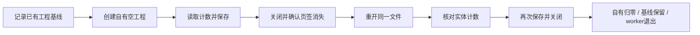

# af_r13_bridge 功能树

更新日期：2026-10-28。对应运行代码基线：`8ff0150`。本树描述新库现状与后续路线；旧库的实现和通过记录不计入新库能力。

状态含义：**[已验]** 已在注明的场景验证；**[已实]** 已实现，但不表示所有分支均已现场验证；**[待做]** 新库尚未实现；**[边界]** 当前限制或未获验证的能力。

## 完整功能树

```text
af_r13_bridge · 独立 AutoForm R13 Bridge
│
├── 1. 公共调用入口 [已实]
│   ├── Python：Bridge.call / Bridge.run_lifecycle / Bridge.batch
│   ├── JSON CLI：capabilities / audit / discover
│   ├── 完整生命周期：lifecycle / call lifecycle
│   ├── 同进程批处理：batch，支持 @alias 与 @last 工程引用
│   └── 统一结果：ok、operation、request_id、document_id/job_id、
│       data、verification_scope、postconditions、evidence、error、elapsed_ms
│
├── 2. 会话与工程所有权 [已实]
│   ├── 发现本机真实 AFFormingUI.exe 与 R13 安装
│   ├── 默认附着唯一 R13；显式 --launch 时启动
│   ├── 启动配置：进程级许可证地址、明确启用后应用已选方案
│   ├── 读取 PID、创建时间、窗口及工程清单
│   ├── 记录已有工程基线，不把基线工程认作自有工程
│   ├── 创建前后唯一新增页签 → 会话 token / RuntimeId 所有权
│   ├── 关闭后退役工程句柄，拒绝过期句柄与歧义目标
│   └── disconnect：停止本 Bridge worker、释放写锁；R13 保持运行
│
├── 3. 工程生命周期 [已验：本机中文 R13 空工程]
│   ├── 创建本轮独立空工程
│   ├── 保存前读取明确的实体计数
│   ├── 保存 / 另存至本轮文件
│   │   ├── 输入绝对路径并读回
│   │   ├── 等待文件框和保存模态结束
│   │   └── 核对页签身份、标题及文件哈希
│   ├── 关闭指定自有页签，并确认从最新清单消失
│   ├── 重开刚才保存的同一个文件，登记新的工程身份
│   ├── 核对保存前后实体计数：零件、模具、坐标系、曲线、点
│   ├── 再次保存 → 关闭 → 确认关闭
│   └── 结束门禁：自有 0、未知新增 0、基线保留、worker 停止
│
├── 4. Windows 适配与执行监督 [已实]
│   ├── Win32：窗口枚举、PID核对、前台与输入命中位置校验
│   ├── UIA：每次重新观察控件、唯一目标定位、当前矩形校验
│   ├── 文件框：原生控件ID定位、Unicode路径输入、有界读回等待
│   ├── 已识别的欢迎框 / 保存临时视口处理
│   ├── 按 R13 PID 的跨进程单写锁
│   ├── 短命 worker、单次超时、异常及取消收尾
│   └── Windows Job Object [已验：真实进程测试，不操作 AutoForm]
│       ├── 挂起创建 → 加入私有 Job → 恢复执行
│       ├── 包含 venv 启动器及其子进程
│       └── 确认 Job 活跃数为 0，并等待已观察到的成员退出
│
├── 5. 证据、隔离与诊断 [已实]
│   ├── 独立环境、依赖版本 / wheel SHA256 / 来源记录
│   ├── 静态源码、模块路径、sys.path、.pth、环境注入审计
│   ├── 每轮新目录，保留请求、响应、日志、截图、文件哈希
│   ├── 开始 / 创建 / 关闭 / 重开 / 结束的工程数和内存检查点
│   ├── 失败清理：仅对确认属于本轮的工程诊断保存并关闭
│   ├── 窄范围 recovery：核对原进程、窗口及有效所有权账本
│   └── 保留失败结果；清理成功不把原失败改为整轮成功
│
├── 6. 零件与工艺业务 Bridge [待做]
│   ├── STEP导入 → 提取 → 零件及输入来源核对
│   ├── 自动冲压方向 → 方向下拉“反向” → 三轴角度读回
│   ├── S355MC / 4 mm材料与厚度设置、模态收尾及读回
│   ├── 成型检查 → 弯曲零件 → 应用 → 本次有效结果确认
│   ├── 空规划 → 拖入U工序 → C-20 × 拉延区域1分配
│   ├── 进入并离开模面编辑器（本路线不生成压料面/补充面）
│   ├── 平板料片 → 复制“料片轮廓线 - 成型检查部分” → 提交核对
│   ├── 压机线 → 润滑 → 库仑摩擦，核对正确上下文
│   ├── C-20模具：自动模型、接触及显示状态分别核对
│   ├── 参考模型：添加 → 定义 → 全部输入 → 确定，不反转
│   └── 唯一测量方案 → 约束条件 → 自由回弹
│
├── 7. 求解与结果 [待做]
│   ├── GUI Start生成模拟输入、新路径保存、绑定本次job
│   ├── 作业监视与显式取消自有作业
│   ├── 本轮工作副本的原生 -check 及完整求解
│   ├── 核对工序、材料、正网格、凸凹模初始化
│   ├── 本次Springback收敛、正确结束顺序、全部 END code=0
│   └── 区分GUI原件、求解副本与最终交付AFD，读回对应结果
│
├── 8. 抱箍工作流与整链验收 [待做]
│   ├── workflow只调用公共Bridge，不绕过接口或调用旧helper
│   ├── 单轮：空工程 → 全部业务 → 求解 → 完整保存关闭生命周期
│   └── 同一版CLI连续三个独立空工程
│       ├── 每轮全部必需阶段通过、少于20分钟、退出码0
│       ├── Springback与全部END0，零人工补点
│       └── 每轮自有页签归零，资源与基线门禁通过
│
├── 9. 独立录制与外部接入 [待做，可后续交付]
│   ├── 被动录屏、鼠标/快捷键事件、窗口归属和时间线
│   ├── 开始 / 标记 / 停止 / 独立会话输出
│   ├── 不记录普通键入字符，不依赖旧 af_recorder
│   └── MCP / HTTP 适配；当前只有 Python API 和 CLI
│
└── 10. 当前能力边界
    ├── [边界] 非空模型、任意零件/材料持久化尚未验收
    ├── [边界] dirty未知；路径证据来自文件框事务，非AFD SDK直接查询
    ├── [边界] 原生专用内存仍增长；未证明全部资源释放或长期稳定
    ├── [待做] 完整AFD应力/应变/回弹数值场与全部CAD拓扑直接读取
    └── [待做] 工程公差判定、参数优化、自动回弹补偿
```

## 已验证生命周期



这里的“读回”仅验证空工程显示的实体计数，不包含材料、工序或求解结果。`lifecycle_ok=true` 与 `e2e_ok=false` 可以同时成立；求解能力尚未实现。

## 代码与文档入口

| 分支 | 实现或说明 |
| --- | --- |
| 公共API、批处理 | [api.py](../src/af_r13_bridge/api.py)、[接口说明](api.md) |
| JSON CLI | [__main__.py](../src/af_r13_bridge/__main__.py) |
| 工程身份、统一结果 | [models.py](../src/af_r13_bridge/models.py) |
| 生命周期 | [lifecycle.py](../src/af_r13_bridge/lifecycle.py) |
| 发现/启动/附着、Windows适配 | [adapters](../src/af_r13_bridge/adapters) |
| 单写锁、Job与worker回收 | [supervisor.py](../src/af_r13_bridge/supervisor.py) |
| 隔离、证据、诊断恢复 | [isolation.py](../src/af_r13_bridge/isolation.py)、[evidence.py](../src/af_r13_bridge/evidence.py)、[recovery.py](../src/af_r13_bridge/recovery.py) |
| 测试、当前验收与限制 | [tests](../tests)、[阶段状态](status-2026-10-28.md)、[实现说明](implementation-notes.md) |

## 验收依据与证据位置

- 当前运行代码基线 `8ff0150`：88项自动测试通过，其中4项使用真实Windows进程、不操作AutoForm。
- 本机第08轮生命周期：39.715秒，既有基线1个保留，自有0、未知新增0；保存、关闭、同文件重开、计数读回、再次关闭全部通过。
- 第08轮独立审计：40项检查通过，63个worker、128份隔离报告、14个源码/安装文件已核对。
- 原始证据保存在本地 `runs/lifecycle-20261028-08/` 与 `runs/verification-20261028-01/unit-tests-final5.log`。`runs/` 被Git忽略，未上传GitHub；本文件提供索引，不替代原件。
- `capabilities` 是实现状态声明，其现有静态引用仍保留第03轮历史场景；本功能树的最新现场结论以第08轮原始证据及阶段状态文档为依据。

后续业务分支来源于独立重建交接中的抱箍录像路线，只列为计划，不表示新库已经拥有旧库的能力。压料面/补充面生成不在当前路线范围内。
